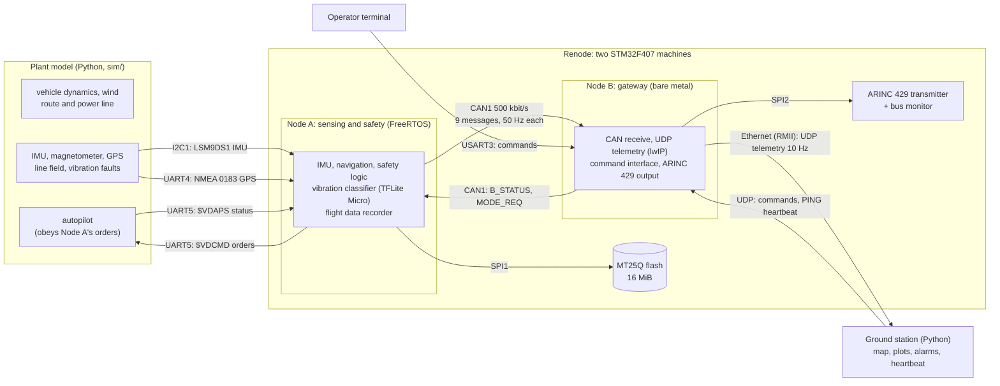
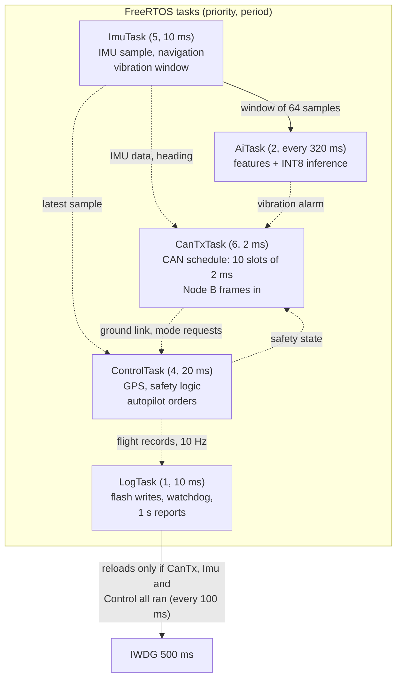
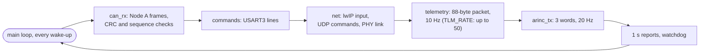
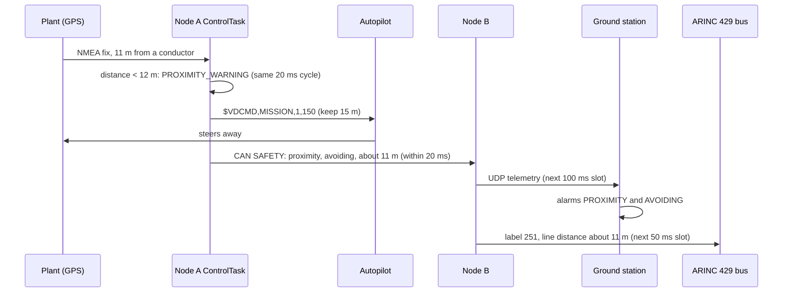

# Architecture

VoltDragon is the avionics of a power-line inspection UAV: two STM32F407
(Cortex-M4F) nodes that run in the Renode emulator, a Python plant model that
stands in for the vehicle and its sensors, and a Python ground station. This page
shows how the parts fit together; each topic has its own page, linked below.

## System

In the co-simulation (`sim/cosim.py`) the plant and both nodes advance in lockstep:
every 20 ms of virtual time the plant computes the next sensor readings and
autopilot status, feeds them into Node A's peripherals, and reads back Node A's
orders. The ground station receives Node B's telemetry over a TAP interface, or
from a recording captured inside Renode (`renode/telemetry_capture.py`).

## Interfaces

| Bus | Node | Pins | Settings | Peer | Protocol |
|-----|------|------|----------|------|----------|
| USART2 | A | PA2 / PA3 | 115200 8N1 | developer | debug console, timestamped log ([debugging](debugging.md)) |
| I2C1 | A | PB6 / PB7 | 100 kHz | LSM9DS1 | accelerometer, gyroscope, magnetometer at 100 Hz |
| SPI1 | A | PA5-PA7, CS PA4 | 8 MHz, mode 0 | MT25Q | flight data recorder, 64-byte records at 10 Hz |
| UART4 | A | PC10 / PC11 | 9600 8N1 | GPS receiver | NMEA 0183 GGA and RMC at 5 Hz |
| UART5 | A | PC12 / PD2 | 115200 8N1 | autopilot | `$VDCMD` / `$VDAPS` ([autopilot link](autopilot-link.md)) |
| CAN1 | A, B | PB8 / PB9 | 500 kbit/s | the other node | 8-byte frames with sequence counter and CRC-8 ([CAN messages](can-messages.md)) |
| USART2 | B | PD5 / PD6 | 115200 8N1 | developer | debug console |
| USART3 | B | PB10 / PB11 | 115200 8N1 | operator | checksummed `$seq,VERB,...*CK` commands ([command interface](command-interface.md)) |
| Ethernet | B | RMII (PA1, PA2, PA7, PC1, PC4, PC5, PG11, PG13, PG14) | 100 Mbit/s | ground station | UDP 5600 telemetry, 5601 commands ([telemetry](telemetry.md)) |
| SPI2 | B | PB13-PB15, CS PB12 | 4 MHz, mode 0 | ARINC 429 transmitter | labels 203, 314, 251 at 20 Hz ([ARINC 429](arinc429.md)) |

## Node A: sensing and safety

Node A runs FreeRTOS with static allocation only. Tasks have rate-monotonic
priorities (shorter period, higher priority); shared data is protected by mutexes
with priority inheritance ([RTOS](rtos.md)).

- **Safety logic** (`safety.c`, HLR-001 to HLR-006): below 12 m from a conductor,
  a proximity warning and an order to keep 15 m; return to home 3 s after the
  ground link is lost and below 20 % battery; land below 10 %; operator mode
  requests checked against a transition table, with an override required to
  leave return-to-home. 100 % MC/DC ([report](mcdc-report.md)).
- **Navigation** (`nav.c`, HLR-008): tilt-compensated magnetometer heading;
  near the line the current's field corrupts the magnetometer, which is detected
  from field strength and dip angle, and the GPS course is used instead.
- **Vibration monitor** (`health.c`, HLR-009): 42 spectral features from
  64-sample windows, an INT8 network on TensorFlow Lite Micro in a 2 KB arena,
  and a 3-of-4 debounce ([Edge AI](edge-ai.md)).
- **Robustness** (HLR-016, HLR-017): a reset record in `.noinit` RAM survives
  resets with the reset cause, count and the last fault's registers.

## Node B: gateway

Node B is a bare-metal super-loop: it wakes on every 1 ms tick or received byte,
polls each service and sleeps again (`wfi`).

## A safety event end to end

What happens when the vehicle drifts towards the line (from
`tests/integration/test_mission.py` and `tests/robot/system_safety.robot`):

## Verification

Each layer checks something the others cannot:

| Layer | Runs | What it shows | Where |
|-------|------|---------------|-------|
| Host unit tests | native gcc, in CI | hardware-independent modules against worked examples and reference vectors | `tests/unit` (12 programs) |
| Structural coverage | clang 19, in CI | 100 % statement, decision and MC/DC of the safety logic | [MC/DC report](mcdc-report.md) |
| Static analysis | cppcheck 2.10, in CI | no open MISRA C:2012 finding | [MISRA report](misra-report.md) |
| System tests | Renode + Robot Framework, in CI | real firmware on emulated hardware, driven open loop: 76 tests | `tests/robot` |
| Closed-loop flights | Renode + plant model, in CI | the system keeps its requirements while flying: 21 tests | `tests/integration` |
| Python tests | pytest, in CI | plant model, ground station, ML pipeline | `tests/python` |
| Traceability | in CI | every HLR refined by LLRs, every LLR named to code and tests that exist | [traceability matrix](traceability.md) |

The requirements are in [HLR.md](requirements/HLR.md) and
[LLR.md](requirements/LLR.md); what simulation cannot show is listed in the
README's *Limitations*.
