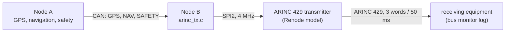

# ARINC 429 Output

Node B puts three of the vehicle's parameters on an ARINC 429 bus, so equipment
built for manned-aircraft avionics (a display, a data recorder, a test set) can
read them without a custom interface (HLR-015, LLR-160 to LLR-163).

## Words

Every 50 ms (20 Hz) Node B sends three BNR words, built from Node A's latest CAN
data. SDI is 0 in all of them.

| Label (octal) | Parameter | Source | Range | Significant bits | Resolution |
|---------------|-----------|--------|-------|-----------------:|------------|
| 203 | Altitude | GPS altitude above mean sea level | ±131 072 ft | 17 | 1 ft |
| 314 | True heading | Node A's heading (magnetometer, or GPS course) | ±180° | 15 | 0.0055° |
| 251 | Distance to the nearest conductor | Node A's safety logic | 0 to 8 192 m | 16 | 0.125 m |

- **314** is the standard ARINC 429 label for true heading, in its usual format.
- **203** is normally pressure altitude, from an air data computer. Node A has no
  barometer, so the GPS altitude is sent in that format to let a standard altitude
  display show it. A real system would use a GNSS altitude label instead; which
  one, and its scaling, belongs in the interface control document agreed with the
  receiving equipment.
- **251** is a project-defined label: ARINC 429 has no assignment for a distance
  to a power line.

Headings from 180° to 359.99° are sent as negative angles (-180° to -0.01°),
as BNR is signed. Values are rounded to the nearest least significant bit and
saturate at the ends of the range.

## Word layout

Bits are numbered 1 (sent first) to 32. In the firmware's `uint32_t`, bit 1 is
the least significant bit (`firmware/common/include/arinc429.h`).

| Bits | Field | Notes |
|------|-------|-------|
| 1-8 | Label | Most significant bit first, so the label's bits are reversed in the integer |
| 9-10 | SDI | 0 |
| 11-29 | Data | BNR: two's complement fraction of the range, sign in bit 29, left-aligned |
| 30-31 | SSM | Sign/status matrix, below |
| 32 | Parity | Odd parity over the whole word |

A worked example, the true heading of 90°: 90 / 180 × 2^15 = 16384 counts. With
15 significant bits the value is shifted left by 18 - 15 = 3 into the 19-bit data
field, giving `0x20000`, which sits at bit 11 as `0x08000000`. SSM "normal" adds
`0x60000000`, and label 314 (`11001100` in binary) goes in reversed as `0x33`.
The word `0x68000033` already has an odd number of ones, so the parity bit stays
clear. The unit tests (`tests/unit/test_arinc429.c`) work through one word per
label like this.

## Status (SSM)

| SSM | Meaning | When Node B sends it |
|-----|---------|----------------------|
| 11 (NO) | Normal operation | The value is available |
| 01 (NCD) | No computed data | Node A runs but has no value: no fresh GPS fix (altitude), no heading source (heading), no distance |
| 00 (FW) | Failure warning | Node A's data is older than 100 ms, the same limit as the telemetry's "Node A fresh" flag |

Words that are not "normal" carry zero data. Node B logs the status of each label
once a second, with the number of words sent:

    arinc: 60 words/s, SPI errors 0; altitude NO, heading NO, line distance NO

## Transmitter

The STM32F4 has no ARINC 429 controller. Real designs pair the MCU with a line
driver and protocol chip on SPI, such as Holt's HI-3593. Renode has no model of
one, so `renode/Arinc429Transmitter.cs` provides a transmitter with a small
command set of the project's own. **These are not the HI-3593's opcodes**: on real
hardware, `arinc_tx.c` must be adapted to the chosen chip's datasheet (opcodes,
transmit FIFO, label bit order option, bus speed setting).

| Command | Bytes | Effect |
|---------|-------|--------|
| Reset | `01` | Forgets any partial command |
| Transmit | `02` `b31..24` `b23..16` `b15..8` `b7..0` | Puts one word on the bus, most significant byte first |
| Read identifier | `03` `00` | The second byte returns `A4` |

A command is the bytes sent while chip select (PB12) is low. SPI2 runs in mode 0
at 4 MHz on PB13 (SCK), PB14 (MISO) and PB15 (MOSI). At start-up Node B resets the
transmitter and reads its identifier; if it does not answer `A4`, Node B logs

    arinc: no transmitter on SPI2 (id 0x00), running without ARINC 429 output

and carries on without the output.

The model puts each word on the bus at once, without modelling the 100 kbit/s
line rate (36 bit times, 0.36 ms per word, including the gap): three words take
about 1.1 ms of every 50 ms on a real bus.

## Bus monitor

The transmitter model decodes every word it sends, independently of the
firmware's encoder, and logs it:

    spi2.arinc: arinc429: label 314 sdi 0 ssm NO data 0x20000 parity ok, true heading 90.00 deg

`tests/robot/system_arinc.robot` checks these lines, so the encoding is verified
against a separate decoder, not only against the unit tests' worked examples.

To watch the bus while the system runs, start it with `renode renode/system.resc`;
the monitor's lines appear in Renode's log window.
